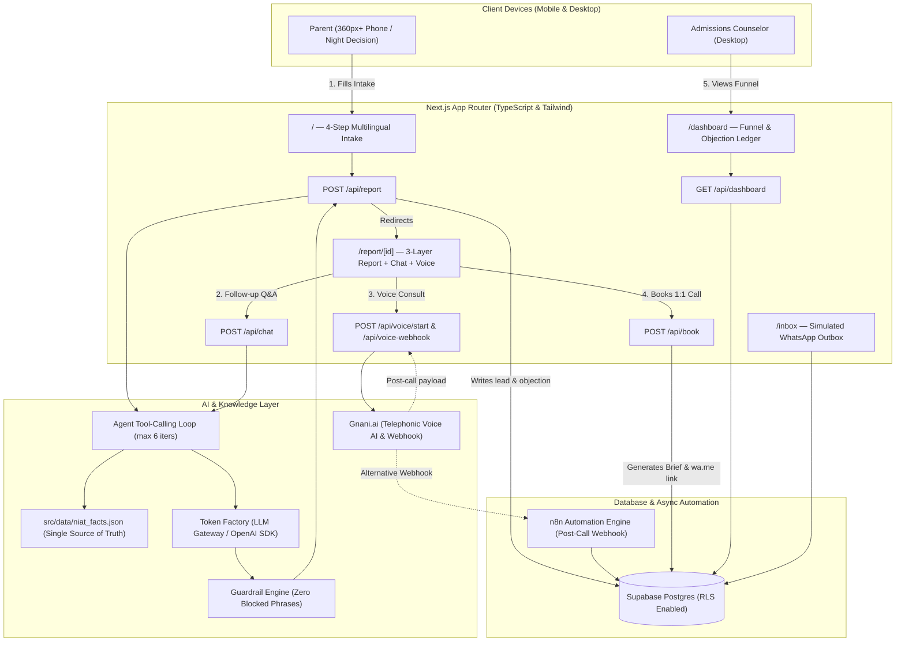

# NIAT Parent Decision Room

A mobile-first, multilingual AI decision companion designed specifically for Indian parents whose children have taken NIAT's NAT (NxtWave Aptitude Test) or attended counseling sessions, but have not yet enrolled.

Instead of generic marketing collateral or aggressive sales calls, the **NIAT Parent Decision Room** provides a calm, family-advisor style experience. Parents receive a transparent 3-layer decision report, answers to their sensitive questions in their mother tongue (English, Hindi, Telugu, Tamil, Kannada, Malayalam), an AI voice consultation option, and an auto-briefed human counselor booking.

---

## 1. Architectural Overview



---

## 2. Core Components & How They Work

### 1. Web Application (`src/app/`)
- **Tone & Design Direction:** Calm, trustworthy, humanist typography (Noto Sans supporting Devanagari, Telugu, Tamil, Kannada, and Malayalam), warm neutral palette (`#FAFAF7`), generous whitespace, no emojis as icons, fully responsive down to 360px width.
- **Intake Flow (`/`):** 4-step progressive disclosure (Language -> Profile -> Campus/Budget -> Primary Concern) preventing parent overwhelm.
- **3-Layer Decision Report (`/report/[id]`):**
  - **Layer 1 (University Degree):** Explicitly states the degree is awarded by NIAT's collaborating accredited university, not NxtWave.
  - **Layer 2 (NIAT Upskilling):** Explains the practical 4-year project-based curriculum layered on top of university theory.
  - **Layer 3 (Placement Support):** Sets realistic expectations with NxtWave's 1000+ hiring network while enforcing that placement is **never guaranteed**.
- **Counselor Dashboard (`/dashboard`):** Real-time conversion funnel, interactive objection ledger bars, intent scoring, and campus/language filtering protected by `DASHBOARD_KEY`.
- **Simulated WhatsApp Outbox (`/inbox`):** Realistic interface displaying dispatches sent to parents (report links, call confirmations) for full auditability.

### 2. Token Factory Agent & Guardrail Engine (`src/lib/agent.ts`, `tools.ts`, `guardrails.ts`)
- **Iterative Tool Calling:** Runs up to 6 iterations resolving tools: `get_niat_facts`, `get_campus_options`, `classify_objection`, `get_objection_response`, `score_intent`, `generate_counselor_brief`, and `log_lead`.
- **Strict Guardrail Enforcement:** Scans every assistant output for blocked promises:
  - `"guaranteed placement"`, `"100% placement"`, `"assured job"`, `"job guarantee"`, `"definite placement"`.
- **Self-Correction:** Automatically retries once with a corrective prompt on violation; returns safe fallback if uncorrected.
- **Unconfirmed Fact Handling:** Replaces any `TODO_VERIFY` values with *"A counselor will confirm this detail."*

### 3. Voice Calling Integration (`/api/voice/start` & `/api/voice-webhook`)
- Connects to Gnani.ai for telephonic inbound/outbound calls in native languages.
- Safe demo mode activates if credentials are omitted.
- Verified webhook endpoint receives transcripts, generates AI summaries, updates parent objection categories, and flags `voice_call_done = true`.

### 4. Supabase Database (`supabase/schema.sql`)
- Strict Row Level Security (RLS) on all tables (`leads`, `chat_messages`, `objection_ledger`, `outbox`).
- All reads and writes are brokered via Server Route handlers using the `service_role` key, preventing any client-side leakage.

---

## 3. Environment Variables

Create `.env.local` using `.env.example` as a template:

| Variable | Description | Required For |
| :--- | :--- | :--- |
| `NEXT_PUBLIC_SUPABASE_URL` | Supabase project URL (`https://xyz.supabase.co`) | Database queries |
| `NEXT_PUBLIC_SUPABASE_ANON_KEY` | Supabase public anonymous key | Client auth contexts |
| `SUPABASE_SERVICE_ROLE_KEY` | Supabase service-role administrative key | Server-side RLS bypass |
| `TOKEN_FACTORY_API_KEY` | Token Factory API Key (OpenAI-compatible) | Report & Chat LLM Agent |
| `TOKEN_FACTORY_BASE_URL` | Base URL for Token Factory (`https://api.tokenfactory.ai/v1`) | Agent completion |
| `TOKEN_FACTORY_MODEL` | Model identifier (e.g. `gpt-4o` or specified deployment) | LLM inference |
| `GNANI_API_KEY` | Gnani.ai API authentication key & webhook secret | Voice AI Gateway |
| `GNANI_AGENT_ID` | Gnani agent voice assistant identifier | Voice session launch |
| `NEXT_PUBLIC_APP_URL` | Public URL of web app (`http://localhost:3000` or production) | WhatsApp links & outbox |
| `COUNSELOR_WHATSAPP_NUMBER` | Counselor WhatsApp phone number (with country code e.g. `919999999999`) | 1:1 call routing |
| `DASHBOARD_KEY` | Secret key protecting the `/dashboard` route | Admissions team portal |

---

## 4. Setup & Running Locally

### Step 1: Install Dependencies
```bash
npm install
```

### Step 2: Configure Database
Open your Supabase SQL editor and execute the contents of:
```bash
supabase/schema.sql
```

### Step 3: Seed Synthetic Leads
Populates 30 realistic leads with drop-off funnel data, objection ledgers, and WhatsApp outbox records:
```bash
npm run seed
```

### Step 4: Run the Development Server
```bash
npm run dev
```

Visit the core routes:
- **Parent Intake:** [http://localhost:3000](http://localhost:3000)
- **Counselor Dashboard:** [http://localhost:3000/dashboard?key=your_dashboard_key](http://localhost:3000/dashboard)
- **WhatsApp Outbox:** [http://localhost:3000/inbox](http://localhost:3000/inbox)

---

## 5. Testing & Verification

### Unit & Guardrail Tests
Validates blocked phrases, TODO_VERIFY scrubbers, and tool calculation logic:
```bash
npm test
```

### Persona Script
Runs 3 diverse parental personas through the decision logic:
1. **Fee-Sensitive Hindi Parent** (Scholarships, EMI)
2. **Placement-Anxious Telugu Parent** (Honest career policy)
3. **Legitimacy-Seeking English Parent** (UGC University vs NIAT layer)

```bash
npm run personas
```

---

## 6. Demo Script for a 3-Minute Loom

| Time | Screen | Talking Point |
| :--- | :--- | :--- |
| **0:00 - 0:30** | `/` (Intake) | "Welcome. Anxious Indian parents deciding on a 4-year, multi-lakh program don't want marketing pressure; they want calm honesty. We select Telugu or Hindi and enter student details." |
| **0:30 - 1:15** | `/` (Steps 2-4) | "Parent selects Vijayawada campus, budget, and primary concern: 'Placement & Jobs'. Notice no flashy gradients—just a clear, readable notebook format." |
| **1:15 - 2:00** | `/report/[id]` | "Here is the 3-Layer Decision Report. Layer 1: Degree awarded by collaborating university. Layer 2: NIAT upskilling. Layer 3: Honest placement policy—no guaranteed placement claims. Notice the expandable Agent Trace proving tool calls." |
| **2:00 - 2:30** | `/report/[id]` | "We test follow-up chat, show 'Share with Spouse' via WhatsApp, and click 'Book Counselor Call'. The system auto-generates a structured brief for the counselor so the parent never repeats themselves." |
| **2:30 - 3:00** | `/dashboard` & `/inbox` | "On the counselor dashboard, we see real-time funnel conversion, objection ledger breakdown, and filter by campus. The WhatsApp Outbox shows exact dispatches sent to parents." |

---

## 7. Known Assumptions & Limitations

1. **Facts Repository Scope:** All university degree notes, campus lists, and placement caveats are strictly bound to `src/data/niat_facts.json`. Fee numbers marked `TODO_VERIFY` always trigger a safe counselor confirmation fallback to prevent accidental hallucinations.
2. **Gnani Voice Credentials:** When `GNANI_API_KEY` is not present, `/api/voice/start` operates in an explanatory **Demo Mode**, ensuring smooth user evaluation without crashes.
3. **WhatsApp Dispatching:** Messages generated during intake and booking are recorded in the `outbox` Postgres table and displayed at `/inbox`. Connecting to WhatsApp Business API requires a Meta Cloud API webhook configuration.
